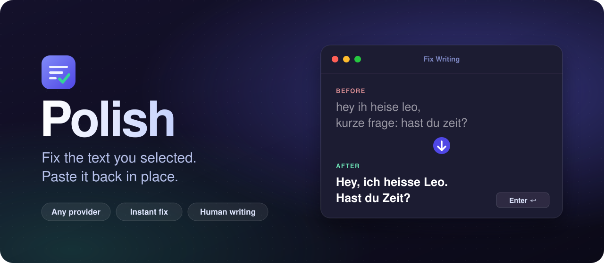

<p align="center">
  
</p>

<p align="center">
  <a href="https://www.raycast.com"></a>
  
  
  <a href="LICENSE"></a>
</p>

<p align="center">
  <b>Select text anywhere. Press your hotkey. The fixed version replaces it.</b><br>
  Works with OpenAI, DeepSeek, OpenRouter, Groq, Ollama or any other OpenAI-compatible API.
</p>

---

## Why Polish

Most AI writing extensions for Raycast show the result in a window, leave the copying to you and lock you into one provider with a fixed model list. Polish goes the other way.

<table>
  <tr>
    <td width="50%" valign="top">
      <h3>Replaces your text in place</h3>
      Press <code>Enter</code> in the preview and the fixed text lands right over your selection. <b>Fix Writing Instantly</b> skips the window completely: select, hotkey, done.
    </td>
    <td width="50%" valign="top">
      <h3>Any provider, your models</h3>
      Point it at any OpenAI-compatible endpoint, including a local Ollama. Type in the model IDs you want and switch between them with <code>Cmd+M</code>.
    </td>
  </tr>
  <tr>
    <td width="50%" valign="top">
      <h3>Reads like you wrote it</h3>
      Optional human writing rules strip em dashes, words like "crucial" or "delve" and empty filler. In messages they drop openers like "Quick question:". Your tone and language stay.
    </td>
    <td width="50%" valign="top">
      <h3>Never loses your text</h3>
      Whenever Polish cannot confirm a text field, or pasting fails, the result also goes to your clipboard. A short message tells you which one happened.
    </td>
  </tr>
</table>

## Commands

| Command | What it does |
| --- | --- |
| **Fix Writing** | Shows the fixed text above your original. `Enter` pastes it, `Cmd+R` retries, `Cmd+M` switches the model. |
| **Fix Writing Instantly** | No window. Fixes the selection with your default model and replaces it. Best on a hotkey. |
| **Shorten Text** | Cuts the selection down to its key facts: requests, questions, dates, names, links. Drops small talk, hedging and repetition, keeps your voice and language. Shows the word count before and after, `Enter` pastes it. |
| **Clean up Text** | For text copied from a terminal. Removes the extra indent and joins hard-wrapped lines back into sentences, while keeping lists, tables and code blocks. Runs in code without AI, so it is instant and never changes a word. |

```text
Before, copied from a terminal:
  - URLs and code are now left alone by
    the replacement.
  - Markdown and line breaks stay as
    they are.

After Clean up Text:
- URLs and code are now left alone by the replacement.
- Markdown and line breaks stay as they are.
```

## Install

You need macOS, [Raycast](https://www.raycast.com), Node 22+ and pnpm.

```sh
git clone https://github.com/unveroleone/raycast-polish.git
cd raycast-polish
pnpm install
pnpm dev
```

Wait for `built extension successfully`, then stop it with `Ctrl+C`. Polish stays in Raycast. The first `pnpm dev` registers the extension, after that `pnpm build` is enough to update it.

Then open **Raycast Settings > Extensions > Polish**, fill in your provider and give the commands a hotkey.

## Providers

| Provider | Base URL | Example models |
| --- | --- | --- |
| OpenAI | `https://api.openai.com/v1` | `gpt-4o-mini` |
| OpenRouter | `https://openrouter.ai/api/v1` | `anthropic/claude-haiku-5.5, deepseek/deepseek-v4-flash` |
| DeepSeek | `https://api.deepseek.com/v1` | `deepseek-chat` |
| Ollama | `http://localhost:11434/v1` | `llama3.1` (no API key needed) |

Put several models in one comma-separated list. The first one is the default.

## Preferences

| Preference | Default | Notes |
| --- | --- | --- |
| Provider Base URL | OpenAI | Any OpenAI-compatible endpoint |
| API Key | empty | Leave empty for Ollama or LM Studio |
| Models | `gpt-4o-mini` | Comma-separated, first one is the default |
| Proxy URL | empty | Only for networks that block direct connections, e.g. `http://proxy.example.com:8080`. Skipped automatically when the proxy cannot be reached |
| Clipboard | off | Copy every result too, not only when Polish cannot confirm a text field |
| Writing Style | on | Human writing rules: no em dashes, no AI-sounding words, Swiss `ss` instead of `ß` |
| Extra Instructions | empty | One-line rule, e.g. `Use British English spelling.` |
| Instructions File | empty | A `.md` or `.txt` style guide for longer rules |

## How pasting works

Polish always pastes over your selection. Before that, it asks macOS (through the accessibility API) whether a text field has focus in the app you selected the text in.

| Focused element | What happens |
| --- | --- |
| Text field, text area or editable web content | Pasted over your selection |
| Anything else, e.g. Sublime Text, a terminal or a web page | Pasted and also copied, so it is never lost |
| Pasting fails | Copied to the clipboard |

Editors like Sublime Text draw their own text view and do not report it as a text field, which is why Polish still pastes there. Raycast needs accessibility access for this (System Settings > Privacy & Security > Accessibility). It already uses that permission to read your selection.

When **Fix Writing** gets text that was copied from a terminal (every line indented, hard line breaks), it runs **Clean up Text** on it first, so the model sees real paragraphs.

## Privacy

Your selected text goes only to the provider you configured. There is no server in between and no tracking. The API key is stored in Raycast as a password preference and never ends up in this repo.

## License

[MIT](LICENSE)
